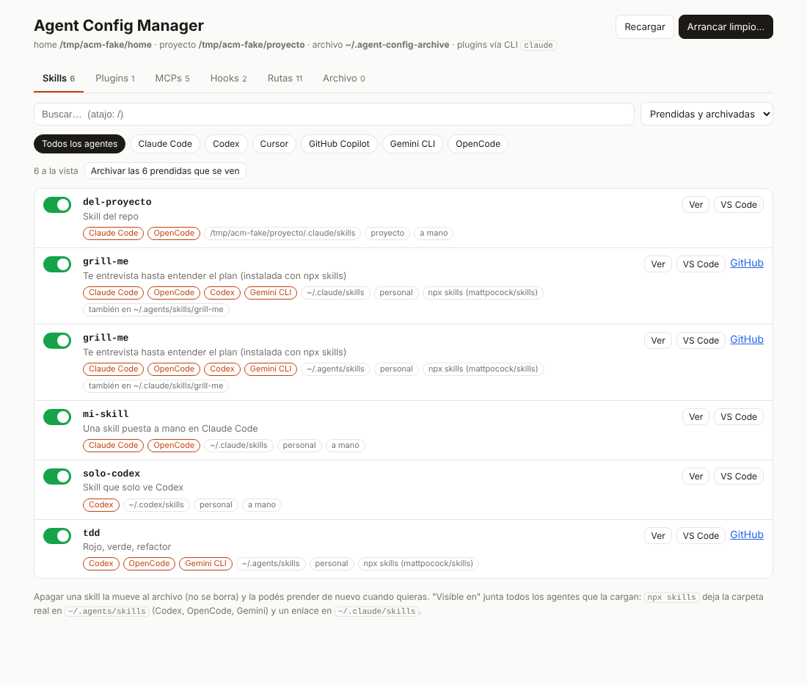

# agent-config-manager

Una página local para ver y ordenar la configuración de tus agentes de código: **skills, plugins, MCPs y hooks** de Claude Code, Codex, Cursor, GitHub Copilot, Gemini CLI y OpenCode. Prendés y apagás cada cosa, la archivás para "arrancar limpio" y la restaurás cuando quieras. Nunca borra nada.

*A local web page to inspect, toggle, archive and restore the skills, plugins, MCP servers and hooks of Claude Code, Codex and other coding agents. Spanish UI.*



## Usarla

Necesita [Bun](https://bun.sh) (`curl -fsSL https://bun.sh/install | bash`). Sin dependencias.

```bash
cd ~/mi-repo                                        # el proyecto cuya config querés ver
bunx github:facundoPri/agent-config-manager         # abre http://localhost:4321
```

O clonando:

```bash
git clone https://github.com/facundoPri/agent-config-manager
cd ~/mi-repo && bun ~/agent-config-manager/src/server.ts
```

Opciones:

| Opción | Para qué |
|---|---|
| `--proyecto <carpeta>` | Proyecto a mirar (por defecto, la carpeta actual) |
| `--puerto 4321` | Puerto |
| `--editor code` | Comando para "Abrir en VS Code" (`cursor`, `zed`, `subl`…). También `AGENT_CONFIG_EDITOR` |
| `--home <carpeta>` | Usar otro home, para probar sin tocar tu configuración |
| `--sin-cli` | No usar la CLI de `claude` para los plugins (lee y escribe los archivos directo) |
| `--no-abrir` | No abrir el navegador |

Para probar con datos falsos: `bun run demo` (crea un home de mentira en `/tmp/acm-demo`).

## Qué muestra

- **Skills.** Cada carpeta de skills sueltas, con qué agentes la cargan y cómo llegó: a mano, enlace a otra carpeta, o `npx skills` (con link al repo y a skills.sh). Si `npx skills` dejó la skill en `~/.agents/skills` y un enlace en `~/.claude/skills`, la fila dice que la ven Claude Code y Codex.
- **Plugins** de Claude Code: qué skills, MCPs, hooks, comandos y agentes trae cada uno, y su página.
- **MCPs**: `~/.claude.json` (usuario y local), `.mcp.json`, `~/.codex/config.toml`, Cursor, Gemini CLI, OpenCode, y los que traen los plugins.
- **Hooks**: settings de Claude Code (usuario, proyecto, local), `~/.codex/hooks.json`, Gemini CLI, y los de los plugins.
- **Rutas**: los archivos y carpetas importantes de cada herramienta, con botones para abrirlos en VS Code, mostrarlos en el Finder o copiar la ruta.
- **Archivo**: todo lo que apagaste, agrupado por cuándo, con "Restaurar todo".
- **Copias**: copias de seguridad de tus skills, agentes, comandos y archivos de configuración.

Cada skill dice además si está respaldada: si su carpeta real está en un repo git (con el remoto y si tiene cambios sin commitear) o si vino de `npx skills` (se puede reinstalar). Las que no tienen ninguna de las dos dicen "sin repo: solo vive acá", y el filtro "Skills sin repo ni origen" te las muestra juntas.

Cada skill tiene su página con el `SKILL.md` completo y los archivos que trae. Tiene link propio: `http://localhost:4321/#/skill/<nombre>`. La tecla `/` va al buscador.

| Agente | Carpetas de skills que lee |
|---|---|
| Claude Code | `~/.claude/skills`, `.claude/skills` |
| Codex | `~/.agents/skills`, `.agents/skills`, `~/.codex/skills` (vieja) |
| Cursor | `~/.cursor/skills`, `.cursor/skills` |
| GitHub Copilot | `~/.copilot/skills`, `.github/skills` |
| Gemini CLI | `~/.gemini/skills`, `~/.agents/skills` |
| OpenCode | `~/.config/opencode/skills`, `~/.claude/skills`, `~/.agents/skills` |

## Cómo apaga cada cosa

Todo lo apagado va a `~/.agent-config-archive/<fecha>-<etiqueta>/` (cambialo con `AGENT_CONFIG_ARCHIVE`).

- **Skill**: mueve la carpeta (o el enlace, sin tocar a dónde apunta) al archivo y anota de dónde salió en `manifest.tsv`.
- **Plugin**: `claude plugin disable` (o `enabledPlugins` en `~/.claude/settings.json` sin la CLI). Claude Code apaga plugins enteros; si querés quedarte con algunas skills de un plugin, usá **Usar sin el plugin** (las copia a `~/.claude/skills`) y apagá el plugin.
- **MCP / hook**: lo saca de su archivo de configuración y lo guarda en `config.json` del archivo. Antes de tocar un archivo de configuración deja una copia en `~/.agent-config-archive/.backups/`.
- **Arrancar limpio**: archiva de una vez skills, plugins, MCPs y hooks (elegís qué y de qué agente) en una sola carpeta, que después restaurás entera.

Restaurar devuelve cada cosa a su lugar y nunca pisa algo que ya exista con el mismo nombre. Los cambios se notan en la próxima sesión del agente. Cerrá Claude Code antes de tocar los MCPs de usuario, porque reescribe `~/.claude.json` al salir.

## Archivo y copias: la diferencia

- **Archivar** (y "Arrancar limpio") *mueve* las cosas fuera de su lugar para que el agente no las cargue. Restaurar las devuelve.
- **Copia de seguridad** *copia* sin mover nada, a `~/.agent-config-backups/<fecha>/` (cambialo con `AGENT_CONFIG_BACKUPS`). Guarda las carpetas de skills, `~/.claude/agents`, `~/.claude/commands` y los archivos de configuración (settings, `~/.claude.json`, `~/.codex/config.toml`, `.mcp.json`, CLAUDE.md, AGENTS.md, locks de `npx skills`, lista de plugins). Los enlaces se guardan como enlaces.
  - "Restaurar las que faltan" devuelve solo las skills que hoy no están, sin pisar nada.
  - "Restaurar también la config" vuelve a poner los archivos de configuración de la copia; antes hace una copia de los actuales.
- "Arrancar limpio" hace una copia de seguridad antes de archivar (se puede destildar).

## Sin Bun: la versión en bash

`bash/skills-toggle.sh` hace lo básico con las skills y usa el mismo archivo, así que se puede mezclar con la página:

```bash
bash/skills-toggle.sh listar                 # skills, plugins, MCPs y hooks
bash/skills-toggle.sh archivar --si          # archiva todas las skills (sin --si, simula)
bash/skills-toggle.sh restaurar --si         # devuelve el último archivo con skills
bash/skills-toggle.sh archivos               # lista lo archivado
bash/skills-toggle.sh web                    # abre la página
```

## Seguridad

Escucha solo en `127.0.0.1`, rechaza pedidos que no vengan de `localhost` y solo mueve cosas dentro de las carpetas de la tabla de arriba. Solo abre en el editor rutas dentro de tu home o del proyecto.

## Desarrollo

```bash
bun test       # archiva y restaura todo sobre un home falso
bun run demo
```

Licencia MIT.
